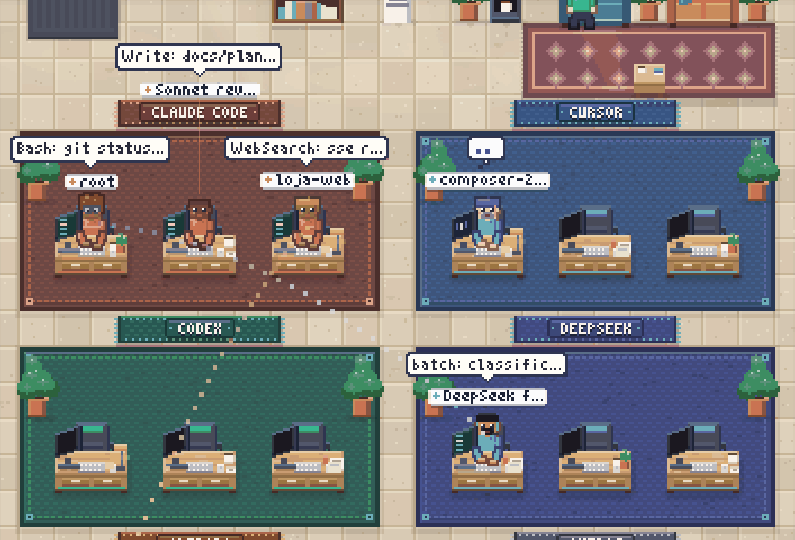
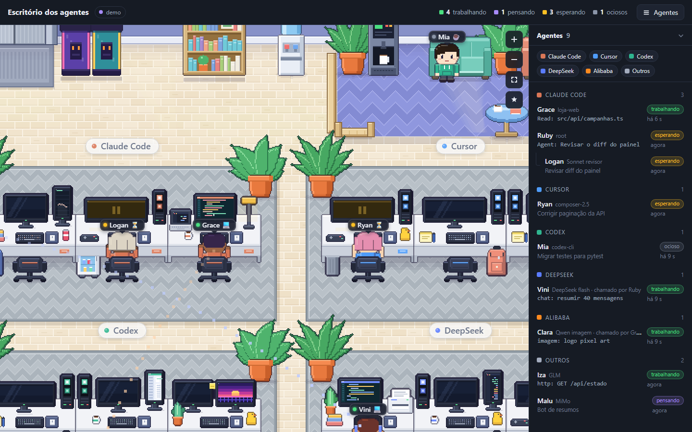
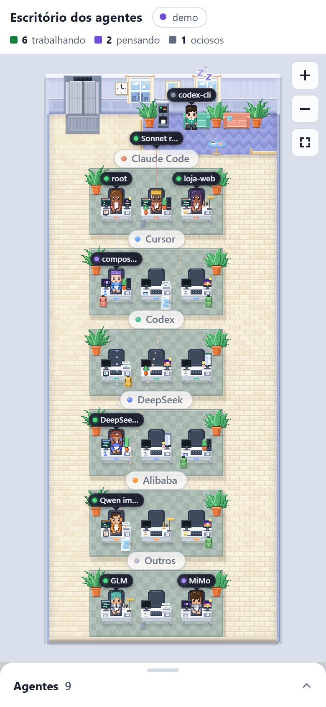
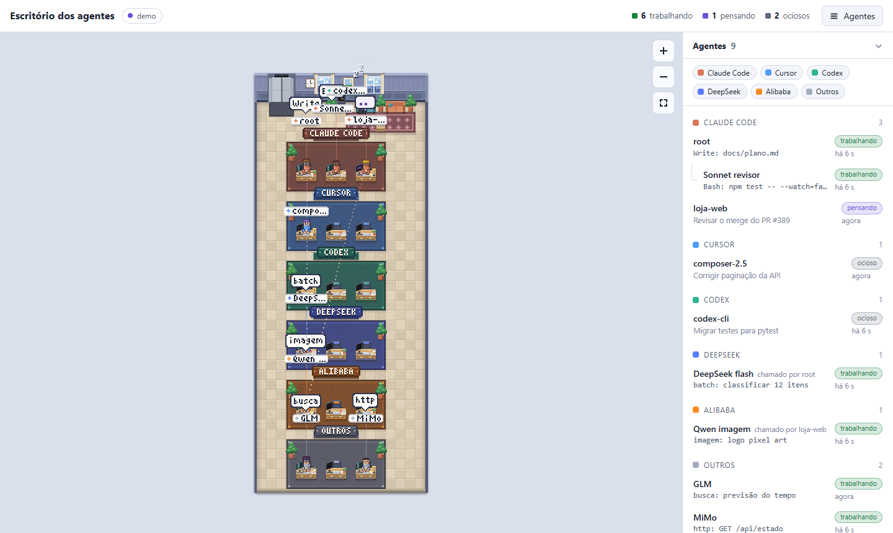
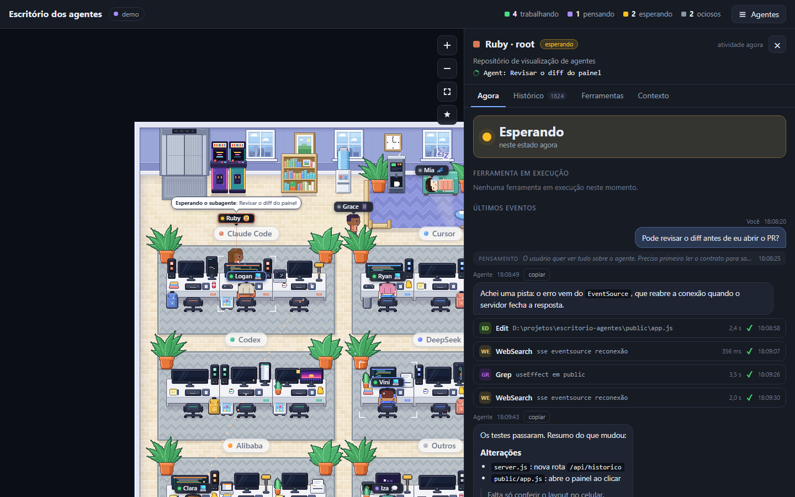

# Escritório dos agentes

Um escritório em pixel art que roda no navegador e mostra, ao vivo, os agentes de IA desta máquina trabalhando. Cada agente é um bonequinho na mesa da sala da plataforma dele. Enquanto roda uma ferramenta, ele digita e mostra num balão o que está fazendo. Quando termina a vez, levanta e vai para o sofá. Subagente senta ao lado de quem o abriu, e um modelo chamado por ferramenta (DeepSeek, imagem na Alibaba) aparece ligado a quem chamou.

**Qualquer LLM entra.** Claude Code, Codex, Cursor e Gemini CLI são lidos direto das transcrições. DeepSeek e Alibaba (Qwen) aparecem quando um agente os chama pelo MCP. GLM, MiMo, Llama, Mistral ou o modelo que for entram com [um `POST`](#pôr-qualquer-coisa-no-escritório): o seu bot, o seu script ou o seu agente caseiro ganha uma mesa na sala.

<p align="center">
  
</p>

- **Sem dependências.** Só Node 20 ou mais novo: nada de `npm install`.
- **Sem hooks.** Ele só lê as transcrições que cada agente já grava em disco.
- **Ao vivo.** O servidor varre as transcrições a cada 1,5 s e empurra o estado para a página por [SSE](https://developer.mozilla.org/pt-BR/docs/Web/API/Server-sent_events).
- **Tudo desenhado em código.** Pessoas, móveis, piso, carpetes, plantas e os textos (nomes, balões e nomes das áreas) são gerados num `<canvas>`, sem nenhuma imagem.

## Começar

```bash
git clone https://github.com/tviniciusas/escritorio-agentes.git
cd escritorio-agentes
npm start                       # http://127.0.0.1:5210
```

Abra [http://127.0.0.1:5210](http://127.0.0.1:5210). Sem nenhum agente rodando, a sala fica vazia. Para ver como ela fica cheia, abra a [demonstração com agentes de mentira](http://127.0.0.1:5210/?demo=1).

```bash
npm run teste                   # testes das fontes e do histórico (node --test)
PORT=5300 npm start             # outra porta
INTERVALO_MS=800 npm start      # varre as transcrições com mais frequência
PASTAS_GRUPO=Empresa npm start  # "projetos/Empresa/loja" aparece só como "loja" nos nomes do Cursor
```

## Como é

| A sala, de perto | Celular |
|---|---|
|  |  |

Cada plataforma ganha uma zona de carpete xadrez neutro, com mesas brancas de postos diferentes entre si. A cor da plataforma aparece em detalhes: a bolinha do nome da área, as telas dos monitores, a faixa da cadeira e a plaquinha da mesa. A parede dos fundos tem janelas, quadros, estante e o elevador, por onde os agentes chegam e vão embora. O lounge, com piso em ziguezague, sofás e divisórias baixas de madeira, é para quem está ocioso.

**Visão geral, com a lista de agentes**



**O detalhe de um agente**

Clicando num agente (na sala ou na lista) abre o painel com tudo o que está na transcrição: pedidos, respostas, pensamentos, cada ferramenta com entrada, saída e duração, arquivos mexidos, tokens, contexto e custo.



### Atalhos

| Ação | Como |
|---|---|
| Zoom | botões `+` e `−`, ou a roda do mouse |
| Voltar ao enquadramento | botão `⛶` |
| Abrir o detalhe | clique no agente; o endereço vira `#agente=<id>` e dá para compartilhar o link |
| Fechar o detalhe e tirar a seleção | `Esc` |
| Esconder uma plataforma | clique no chip dela na lista |
| Ligar ou desligar as animações | botão `★` (a escolha fica guardada no navegador) |

### Animações

A sala reage ao que acontece com os agentes. Tudo sai das transcrições, sem hook nenhum.

| Quando | O que acontece |
|---|---|
| Um agente principal só está esperando os subagentes (ferramenta `Agent`/`Task`, ou terminou a vez com subagentes ainda trabalhando) | Vai ao saguão jogar luta num dos dois fliperamas ao lado do elevador. Com os dois ocupados, o próximo fica atrás, assistindo. Volta para a mesa quando volta a trabalhar. |
| Um agente abre um subagente ou chama o DeepSeek ou a Alibaba | Vai até a mesa do novato, espera ele sentar e estala o chicote três vezes (`CRACK!`). O novato pula a cada estalo e responde "Sim, senhor!". |
| Uma ferramenta dá erro | Quem chamou o agente que errou vem reclamar, de punho erguido e veia saltando, e o agente pede desculpa. Agente principal não tem chefe na sala, então o **Chefe** (terno, gravata vermelha e bigode) sobe pelo elevador, dá a bronca e vai embora. |
| O usuário interrompe ou recusa uma ferramenta | Susto: pulo na cadeira, gota de suor e "Ué?!". |
| O contexto é compactado | Estrelinhas girando em volta da cabeça e "Quem sou eu?". |
| Um subagente termina | Levanta com os braços para cima, solta confete e vai embora pelo elevador. |
| O agente pergunta algo ao usuário (`AskUserQuestion`, `ask` do Telegram) | Levanta a mão acenando: "Ô humano!" e a pergunta no balão. |

Cada animação tem um intervalo mínimo por agente (a bronca, por exemplo, no máximo uma a cada 45 s), para a sala não virar bagunça numa sessão que erra muito. Para ver uma na hora, abra o console do navegador:

```js
__escritorio.office.testar('chicote')   // ou: bronca, chefe, fliperama, susto, tonto, comemora
```

Sem argumento, ele escolhe o agente selecionado (ou um qualquer). O [`?demo=1`](http://127.0.0.1:5210/?demo=1) dispara todas de tempos em tempos.

## O que ele enxerga

| Plataforma | De onde lê | Observações |
|---|---|---|
| [Claude Code](https://github.com/anthropics/claude-code) | `~/.claude/projects/<pasta>/<sessão>.jsonl` | Sessões do VS Code, do terminal e as abertas por outros programas. |
| Subagentes do Claude | `<sessão>/subagents/agent-<id>.jsonl` e `.meta.json` | Sentam ao lado do agente que os abriu. |
| [DeepSeek](https://api-docs.deepseek.com), [Alibaba](https://www.alibabacloud.com/product/modelstudio) e Telegram | chamadas `mcp__deepseek__*`, `mcp__alibaba__*` e `mcp__telegram__*` dentro das sessões do Claude | Viram personagens "chamados", ligados a quem chamou, enquanto a chamada está aberta. |
| [Cursor](https://cursor.com/cli) | `~/.cursor/projects/<pasta>/agent-transcripts/<id>/<id>.jsonl` | O Cursor CLI e o agente da janela. As transcrições não têm horário: o tempo vem da data do arquivo. |
| [Codex CLI](https://github.com/openai/codex) | `~/.codex/sessions/**/rollout-*.jsonl` | Pelo formato documentado. Ainda não testado com uma sessão real. |
| [Gemini CLI](https://github.com/google-gemini/gemini-cli) | `~/.gemini/tmp/<hash>/chats/*.json` | Idem. |
| Qualquer outro LLM ou programa | `POST /api/agente` | GLM, MiMo, Llama, Mistral, bots, assistentes de voz, scripts. Ver abaixo. |

O histórico lê a transcrição de forma incremental (guarda até onde leu), então até as sessões de 40 MB respondem em menos de 0,1 s depois da primeira leitura.

## Pôr qualquer coisa no escritório

Qualquer programa entra na sala com um `POST /api/agente`. Só `id` e `estado` são obrigatórios. O agente some depois de 2 minutos sem atualização, ou na hora com `"estado": "encerrado"`. Os estados são `trabalhando`, `pensando`, `esperando`, `ocioso` e `encerrado`.

**curl**

```bash
curl -s -X POST http://127.0.0.1:5210/api/agente -H "Content-Type: application/json" \
  -d '{"id":"bot:1","plataforma":"outro","nome":"Meu bot","estado":"trabalhando","ferramenta":"busca","detalhe":"previsão do tempo"}'
```

Mande também o `modelo` (`"glm"`, `"mimo"`, `"llama-4"`…) e ele aparece no painel de detalhe. Com `"erro": true` (ou `"erro": "nome da ferramenta"`), o Chefe sobe para dar bronca no seu bot.

**Node**

```js
async function avisar(estado, ferramenta = null, detalhe = null) {
  await fetch('http://127.0.0.1:5210/api/agente', {
    method: 'POST',
    headers: { 'Content-Type': 'application/json' },
    body: JSON.stringify({ id: 'bot:1', plataforma: 'outro', nome: 'Meu bot', modelo: 'glm', estado, ferramenta, detalhe }),
  }).catch(() => {});   // escritório fechado não pode derrubar o bot
}

await avisar('trabalhando', 'http', 'GET /api/clima');
// ...
await avisar('encerrado');
```

**Python**

```python
import json, urllib.request

def avisar(estado, ferramenta=None, detalhe=None):
    corpo = json.dumps({"id": "script:backup", "plataforma": "outro", "nome": "Backup",
                        "estado": estado, "ferramenta": ferramenta, "detalhe": detalhe}).encode()
    req = urllib.request.Request("http://127.0.0.1:5210/api/agente", corpo,
                                 {"Content-Type": "application/json"})
    try: urllib.request.urlopen(req, timeout=2)
    except OSError: pass

avisar("trabalhando", "pg_dump", "banco de produção")
```

**Um comando longo do terminal**

```bash
# põe um bonequinho trabalhando enquanto o comando roda
na-sala() {
  local id="sh:$$" cmd="${*//\"/}" corpo
  corpo=$(printf '{"id":"%s","plataforma":"outro","nome":"terminal","estado":"trabalhando","ferramenta":"Bash","detalhe":"%s"}' "$id" "${cmd:0:60}")
  curl -s -X POST localhost:5210/api/agente -H "Content-Type: application/json" -d "$corpo" >/dev/null
  "$@"; local r=$?
  curl -s -X POST localhost:5210/api/agente -H "Content-Type: application/json" -d "{\"id\":\"$id\",\"estado\":\"encerrado\"}" >/dev/null
  return $r
}

na-sala npm run build
```

## Ler o estado de outro programa

```bash
curl -s http://127.0.0.1:5210/api/estado | jq '.agentes[] | {nome, estado, ferramenta, detalhe}'
curl -N http://127.0.0.1:5210/api/eventos                       # SSE: o estado inteiro a cada mudança
curl -s "http://127.0.0.1:5210/api/historico?id=claude:<sessão>" # o histórico de um agente
```

As rotas, os campos do estado e o formato do histórico estão em [CONTRATO.md](CONTRATO.md).

## Subir junto com o VS Code

Uma tarefa com `runOn: folderOpen` no `.vscode/tasks.json` da pasta que você mais abre sobe o servidor quando o VS Code abre, e ele fecha junto com o VS Code. Ative `"task.allowAutomaticTasks": "on"` nas configurações.

```jsonc
{
  "version": "2.0.0",
  "tasks": [
    {
      "label": "escritorio-agentes",
      "type": "shell",
      "command": "node",
      "args": ["/caminho/para/escritorio-agentes/server.js"],
      "isBackground": true,
      "runOptions": { "runOn": "folderOpen" },
      "presentation": { "reveal": "never", "panel": "dedicated" },
      "problemMatcher": []
    }
  ]
}
```

Se a porta já estiver em uso, o servidor avisa e sai: o escritório já está aberto em outra janela.

## Como funciona

```
transcrições em disco ──► fontes/*.js ──► server.js ──SSE──► public/app.js ──► public/render.js (canvas)
POST /api/agente ───────────────────────────┘                    └──► public/detalhe.js (painel)
```

| Arquivo | O que faz |
|---|---|
| [`server.js`](server.js) | Servidor HTTP: junta as fontes, serve `public/` e as rotas `/api/*`. |
| [`fontes/claude.js`](fontes/claude.js) | Sessões e subagentes do Claude Code, e os personagens "chamados" pelo MCP. |
| [`fontes/cursor.js`](fontes/cursor.js) | Agentes do Cursor. |
| [`fontes/outras.js`](fontes/outras.js) | Codex e Gemini. |
| [`fontes/historico.js`](fontes/historico.js) | Leitura incremental do histórico completo de um agente. |
| [`public/render.js`](public/render.js) | A cena: tiles, zonas, móveis, pessoas, caminhos (BFS), nomes e balões. |
| [`public/gags.js`](public/gags.js) | As animações: fliperama, chicote, bronca e o Chefe, susto, tonto, comemoração e mão levantada. |
| [`public/app.js`](public/app.js) | Lista, filtros, zoom, seleção e a ligação com o SSE. |
| [`public/detalhe.js`](public/detalhe.js) | O painel de detalhe (Agora, Histórico, Ferramentas, Contexto). |
| [`public/demo.js`](public/demo.js) | Os agentes de mentira do `?demo=1`. |

O mundo é desenhado em pixels lógicos e ampliado por um fator inteiro, então os pixels ficam nítidos em qualquer zoom; os textos (nomes e balões) são desenhados depois, em resolução de tela, com a fonte do sistema. A profundidade sai do y dos pés: quem está mais embaixo na tela é desenhado na frente.

## Privacidade

O servidor só lê arquivos e só escuta em `127.0.0.1`. Na sala aparece só o nome da ferramenta e um resumo curto, mas o painel de detalhe mostra a transcrição inteira, inclusive saídas de comandos, que podem ter caminhos, trechos de código e segredos. **Não abra a porta para a rede** (`HOST=0.0.0.0`) sem pôr autenticação na frente.

## Sem hooks

Ele não instala hook nem plugin em nenhum agente: só lê as transcrições que cada um já grava. Assim não interfere no Claude Code, no Cursor nem nos outros, e desligar o escritório não muda nada neles.
